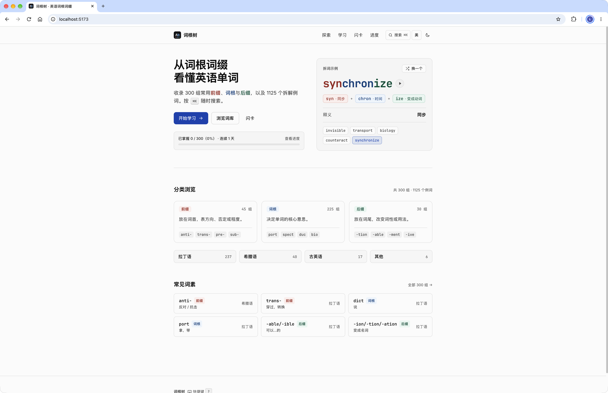
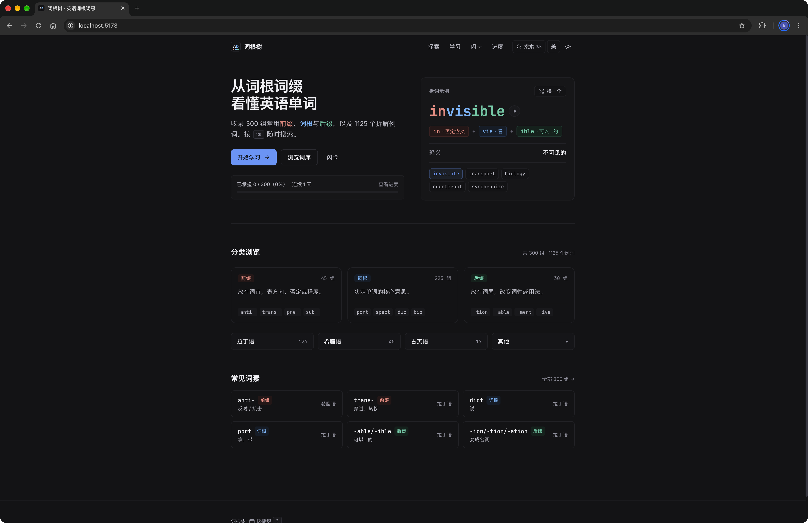
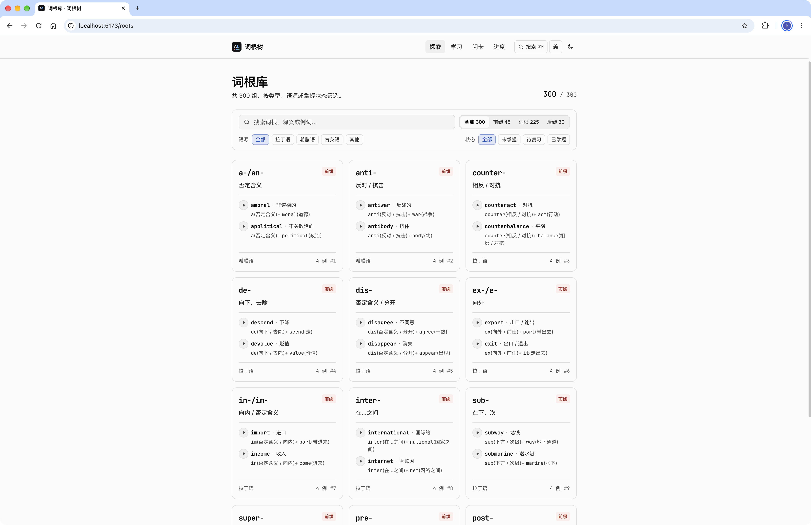
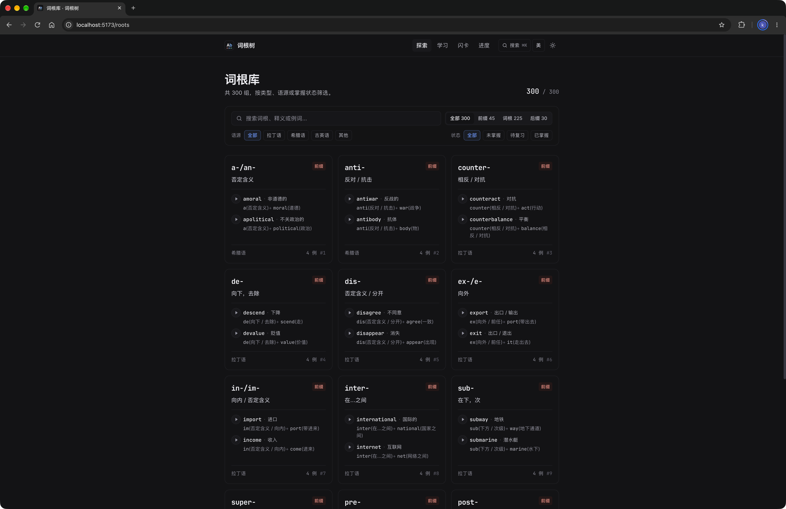
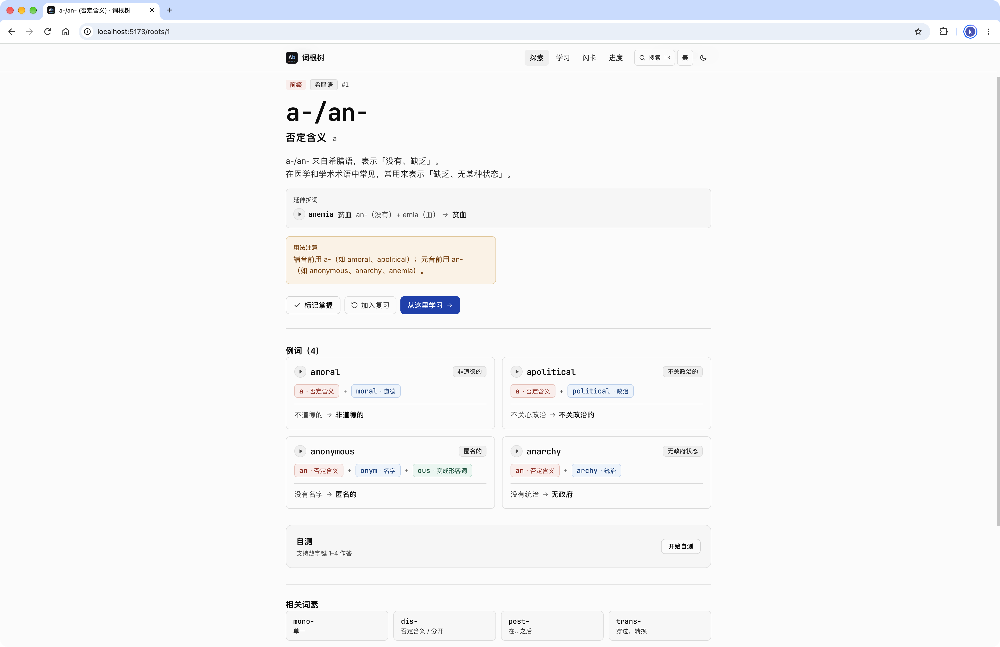
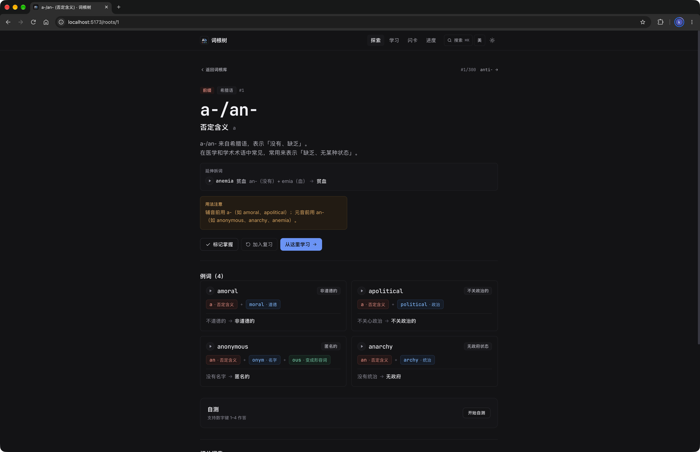

<div align="center">
  <a href="https://english-roots.netlify.app">
    
  </a>

  <h1>English Roots</h1>

  <p>
    A static English vocabulary workbench built around word-formation formulas (<code>Word = Prefix + Root + Suffix</code>)<br />
    300 High-Frequency Morphemes · 1,125 Decomposed Words · US/UK Audio · Leitner Spaced Repetition
  </p>

  <p>
    <a href="https://english-roots.netlify.app">
      
    </a>
    
    
    
  </p>

  <p>
    <a href="https://english-roots.netlify.app"><strong>Live Demo</strong></a>
    &nbsp;·&nbsp;
    <a href="https://english-ipa.netlify.app">English IPA</a>
    &nbsp;·&nbsp;
    <a href="./README.md">简体中文</a>
  </p>
</div>

<br />

<table>
  <tr>
    <td width="50%" align="center">
      
      <br />
      <sub>Light · Home Workbench</sub>
    </td>
    <td width="50%" align="center">
      
      <br />
      <sub>Dark · Home Workbench</sub>
    </td>
  </tr>
  <tr>
    <td width="50%" align="center">
      
      <br />
      <sub>Light · Root Directory</sub>
    </td>
    <td width="50%" align="center">
      
      <br />
      <sub>Dark · Root Directory</sub>
    </td>
  </tr>
  <tr>
    <td width="50%" align="center">
      
      <br />
      <sub>Light · Morpheme Detail</sub>
    </td>
    <td width="50%" align="center">
      
      <br />
      <sub>Dark · Morpheme Detail</sub>
    </td>
  </tr>
</table>

## Features

- **Home Workbench (`/`)**: Interactive word-decomposition showcase, quick filters by prefix / root / suffix and etymology, and curated core morphemes.
- **Global Search (`⌘K` / `/`)**: Instant search across all 300 morphemes and 1,125 example words with inline formula previews, US/UK pronunciation, and keyboard navigation.
- **Root Directory & Details (`/roots` · `/roots/[id]`)**: Filter by morpheme type, etymology, and mastery status; all 300 detail pages are statically prerendered with inline self-check quizzes.
- **Guided Study & Flashcards (`/learn` · `/flashcard`)**: Two-step study and closed-book recall flow with 3-tier Leitner spaced-repetition scheduling and full keyboard control.
- **Progress & Preferences (`/progress`)**: Mastery breakdown, due-review queue, Light / Dark / System themes, US/UK accent switch, and local JSON backup/restore.

## Development

SvelteKit + Svelte 5 (Runes) + Tailwind CSS v4 + `@sveltejs/adapter-static` + Vitest.

```bash
pnpm install
pnpm dev                # Local dev server
pnpm audit:word-roots   # Audit all 300 morpheme records
pnpm type-check         # Svelte 5 + TypeScript check
pnpm test               # Contrast, search & unit tests
pnpm build              # Static prerender to build/
```

## Acknowledgements

- Morpheme dataset and initial inspiration originate from [joeseesun/word-root-workshop](https://github.com/joeseesun/word-root-workshop); rebuilt and redesigned with Svelte 5.
