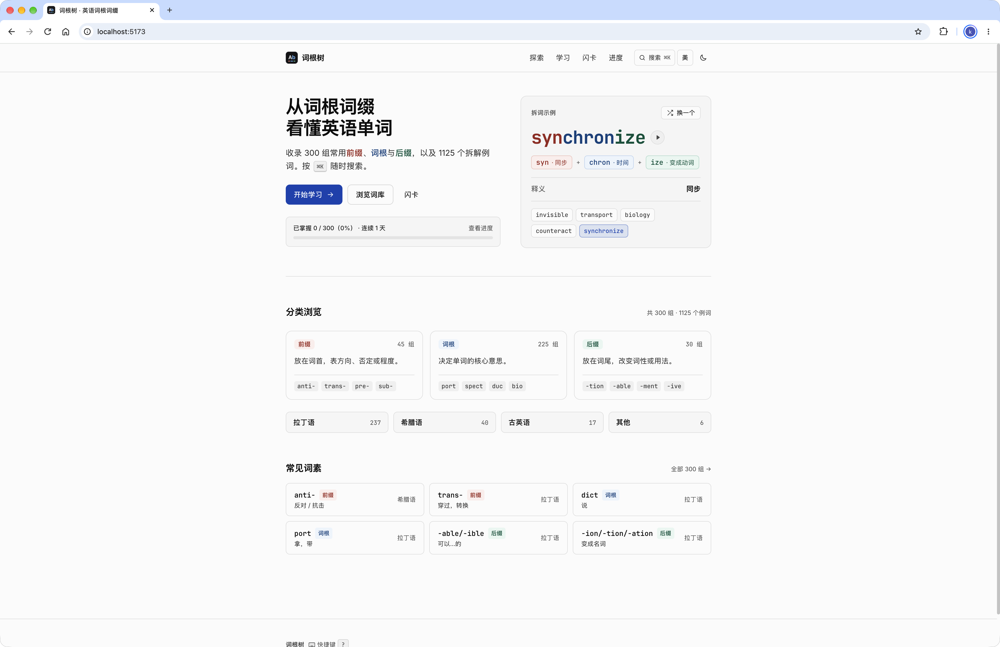
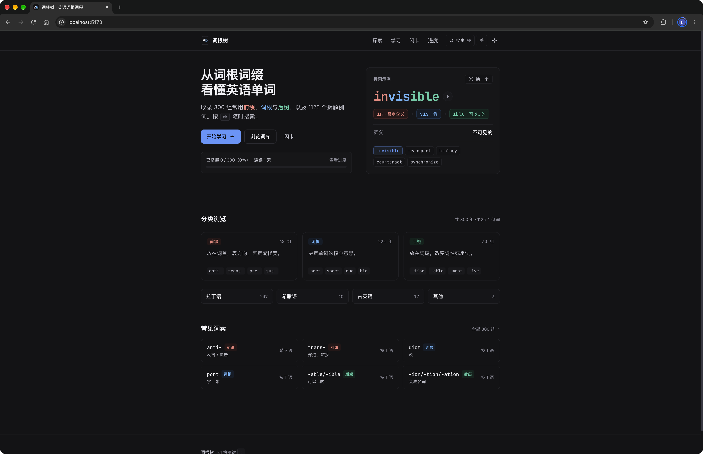
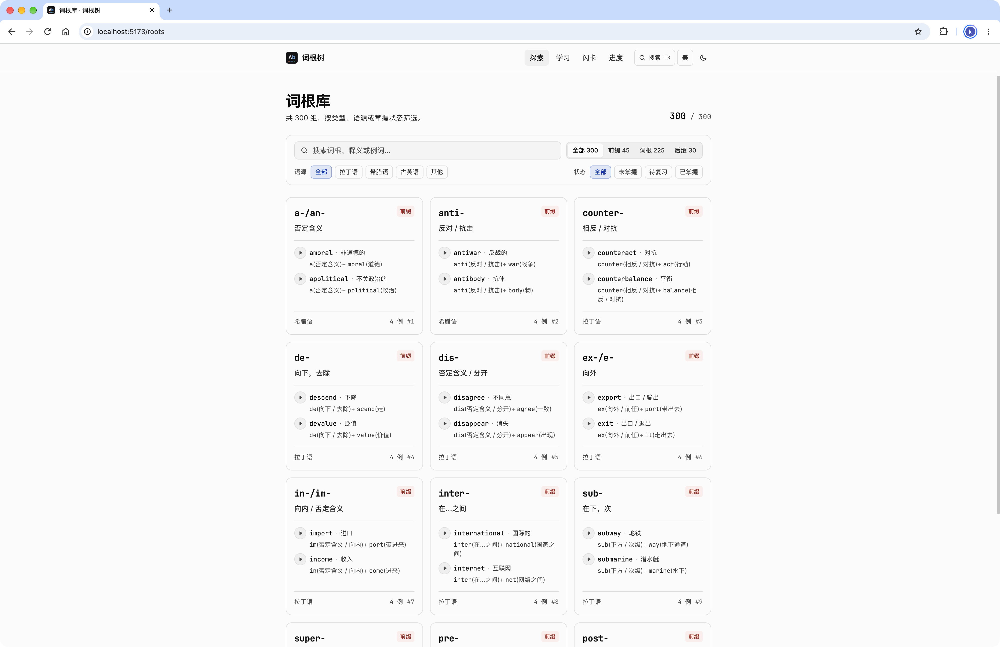
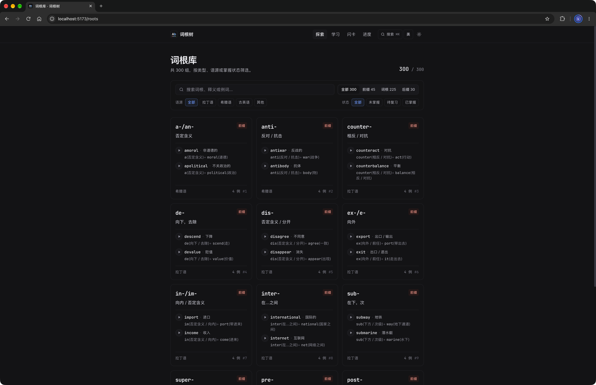
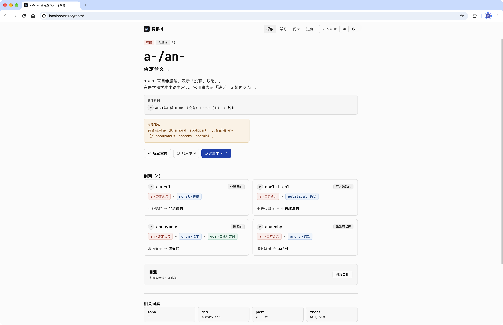
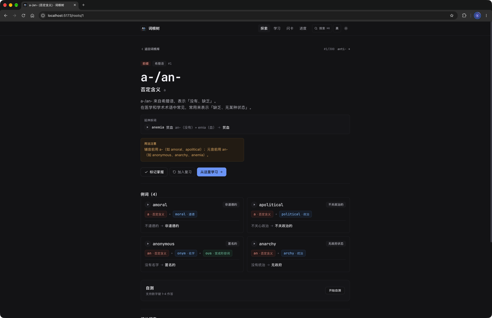

<div align="center">
  <a href="https://english-roots.netlify.app">
    
  </a>

  <h1>词根树</h1>

  <p>
    用构词公式（<code>单词 = 前缀 + 词根 + 后缀</code>）理解与记忆英语单词的纯静态学习工作台<br />
    300 组高频词素 · 1,125 个拆解例词 · 美/英双口音发音 · Leitner 间隔复习
  </p>

  <p>
    <a href="https://english-roots.netlify.app">
      
    </a>
    
    
    
  </p>

  <p>
    <a href="https://english-roots.netlify.app"><strong>在线预览</strong></a>
    &nbsp;·&nbsp;
    <a href="https://english-ipa.netlify.app">音标表</a>
    &nbsp;·&nbsp;
    <a href="./README.en.md">English</a>
  </p>
</div>

<br />

<table>
  <tr>
    <td width="50%" align="center">
      
      <br />
      <sub>浅色 · 首页工作台</sub>
    </td>
    <td width="50%" align="center">
      
      <br />
      <sub>深色 · 首页工作台</sub>
    </td>
  </tr>
  <tr>
    <td width="50%" align="center">
      
      <br />
      <sub>浅色 · 词根库</sub>
    </td>
    <td width="50%" align="center">
      
      <br />
      <sub>深色 · 词根库</sub>
    </td>
  </tr>
  <tr>
    <td width="50%" align="center">
      
      <br />
      <sub>浅色 · 词素详情</sub>
    </td>
    <td width="50%" align="center">
      
      <br />
      <sub>深色 · 词素详情</sub>
    </td>
  </tr>
</table>

## 核心功能

- **首页工作台（`/`）**：可交互构词拆词示例、按前缀 / 词根 / 后缀与语源直达，以及高频核心词素速览。
- **全局检索（`⌘K` / `/`）**：即时搜索 300 组词素与 1,125 个例词，支持预览拆词公式、美/英发音与键盘跳转。
- **词根库与详情（`/roots` · `/roots/[id]`）**：按词素类型、语源与掌握状态多维筛选，预渲染全部 300 个词素详情页并附随堂自测。
- **沉浸学习与闪卡（`/learn` · `/flashcard`）**：分离精读与合卷自测两步流程，支持 Leitner 三档间隔复习调度与全键盘操作。
- **进度与偏好（`/progress`）**：三维掌握统计、待复习清单、浅色 / 深色 / 跟随系统主题、美/英口音及 JSON 本地备份。

## 本地开发

SvelteKit + Svelte 5（Runes）+ Tailwind CSS v4 + `@sveltejs/adapter-static` + Vitest。

```bash
pnpm install
pnpm dev                # 本地开发
pnpm audit:word-roots   # 校验 300 条词素数据
pnpm type-check         # Svelte 5 + TypeScript 检查
pnpm test               # 对比度、搜索与核心单测
pnpm build              # 静态预渲染至 build/
```

## 致谢

- 词素数据与构词灵感源自 [joeseesun/word-root-workshop](https://github.com/joeseesun/word-root-workshop)，本项目在此基础上使用 Svelte 5 重新设计与重构。
